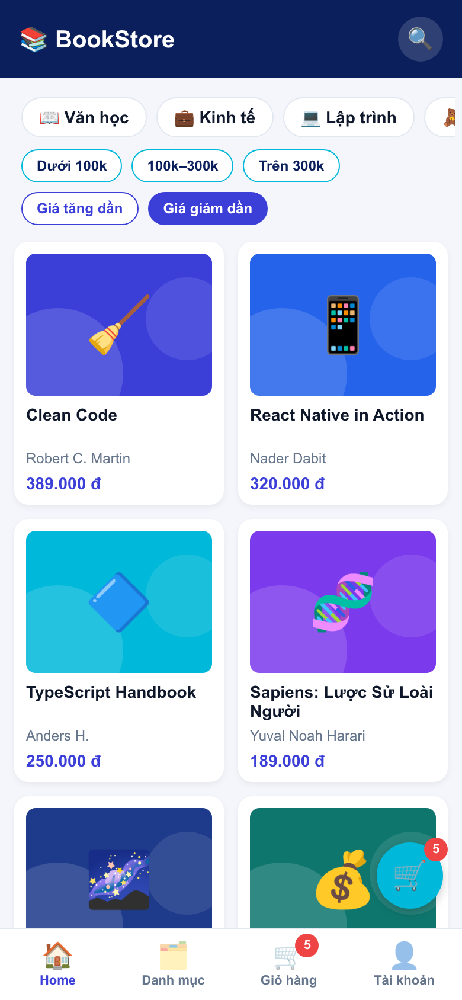

# Trả lời câu hỏi bổ sung — Buổi 7

## Câu 1. Cấu trúc điều hướng

BookDetail là màn con mở đè lên toàn bộ ứng dụng, nên đặt ở Stack thì nó che luôn Tab Bar, có sẵn nút ← và quay lại đúng vị trí cũ. Nếu đặt vào Tab, Tab Bar vẫn hiện, không có nút ←, và `state.routes` có thêm một route nên `CustomTabBar` sẽ vẽ thêm mục thứ 5. Bấm vào mục đó thì không có `bookId`, nên dòng `const { bookId } = route.params` sẽ gây lỗi.

## Câu 2. Redux

Redux Toolkit dùng Immer: `state` trong reducer là một bản nháp (draft), lệnh `push` chỉ ghi nhận thay đổi trên bản nháp, sau đó Immer tạo ra state mới và giữ nguyên state gốc. Bỏ `useMemo` trong `useCart` thì số hiển thị không đổi, vì tổng vẫn được tính từ cùng `items`. Hậu quả là `reduce` chạy lại ở mọi lần render của mọi component dùng `useCart`, kể cả khi giỏ không đổi; giỏ nhỏ thì khó thấy, giỏ lớn mới tốn. `useMemo` ở đây chỉ để tối ưu, không quyết định kết quả đúng hay sai.

## Câu 3. Promise.all

`Promise.all` bị reject ngay khi một promise lỗi, nên `load()` nhảy vào `catch` và Home chỉ hiện ErrorView, dù sách đã tải được. Dùng `Promise.allSettled` thì chờ cả hai xong và xử lý riêng từng kết quả:

```ts
const [b, c] = await Promise.allSettled([getBooks(), getCategories()]);
if (b.status === "fulfilled") setBooks(b.value);
else setError(getErrorMessage(b.reason));          // không có sách thì mới báo lỗi cả màn
if (c.status === "fulfilled") setCategories(c.value); // lỗi danh mục: chỉ thiếu hàng chip
```

Đánh đổi: code dài hơn, phải tự kiểm tra `status` của từng phần. Ngoài ra màn hình có thể thiếu chip danh mục mà người dùng không biết vì sao, nên cần thêm thông báo hoặc nút thử lại riêng cho phần đó. Bài nộp vẫn giữ `Promise.all` đúng theo đề.

## Câu 4. Debounce

`setTimeout` đặt thẳng trong `onChangeText` không bị huỷ khi gõ tiếp, nên mỗi phím vẫn gây một lần lọc, chỉ là trễ 400 ms chứ không gộp lại thành một lần. Trong `useDebounce`, mỗi lần `value` đổi thì hàm dọn dẹp huỷ hẹn giờ cũ, nên chỉ lần gõ cuối được áp dụng. Hàm `return () => clearTimeout(t)` tránh hai lỗi: từ khoá cũ được áp dụng vào danh sách, và gọi `setState` sau khi component đã bị gỡ (unmount).

## Câu 5. Code bổ sung: sắp xếp theo giá

Thêm một state và sửa `visibleBooks` trong `src/screens/HomeScreen.tsx`:

```tsx
const [sort, setSort] = useState<SortOrder>(null); // "asc" | "desc" | null

const visibleBooks = useMemo(() => {
  const filtered = filterBooks(books, { keyword: debouncedKeyword, categoryId, priceRange });
  if (sort === null) return filtered;
  return [...filtered].sort((a, b) => (sort === "asc" ? a.price - b.price : b.price - a.price));
}, [books, debouncedKeyword, categoryId, priceRange, sort]);
```

`[...filtered]` tạo bản sao vì `sort` sửa trực tiếp mảng. Hai nút bấm nằm trong `src/components/SortButtons.tsx`, bấm lần nữa để bỏ sắp xếp. Sắp xếp không phải bộ lọc nên nút “Xóa bộ lọc” không đặt lại nó.

Kết quả:

| Giá tăng dần | Giá giảm dần |
|---|---|
|  |  |

## Thử thách BT7.C1: vì sao đổi thư viện state thì giao diện không phải sửa?

Component chỉ gọi `useWishlist()` và dùng `isFavorite`, `toggle`, không import gì từ Redux. Hook trong `src/store/hooks.ts` đóng vai trò adapter, nên khi đổi sang thư viện khác chỉ cần viết lại phần bên trong hook và giữ nguyên các giá trị trả về.
